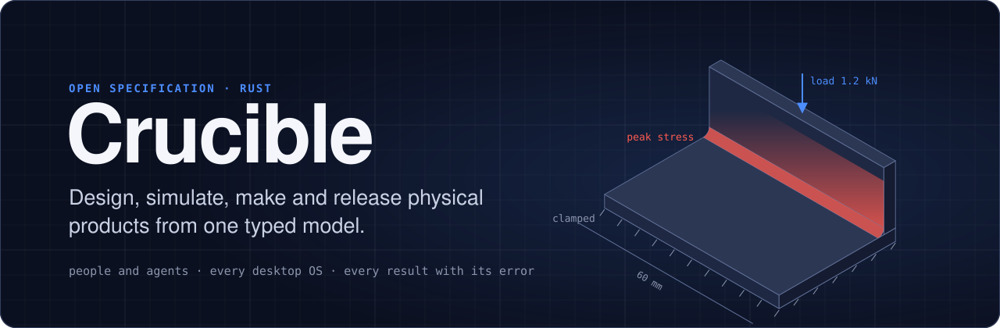
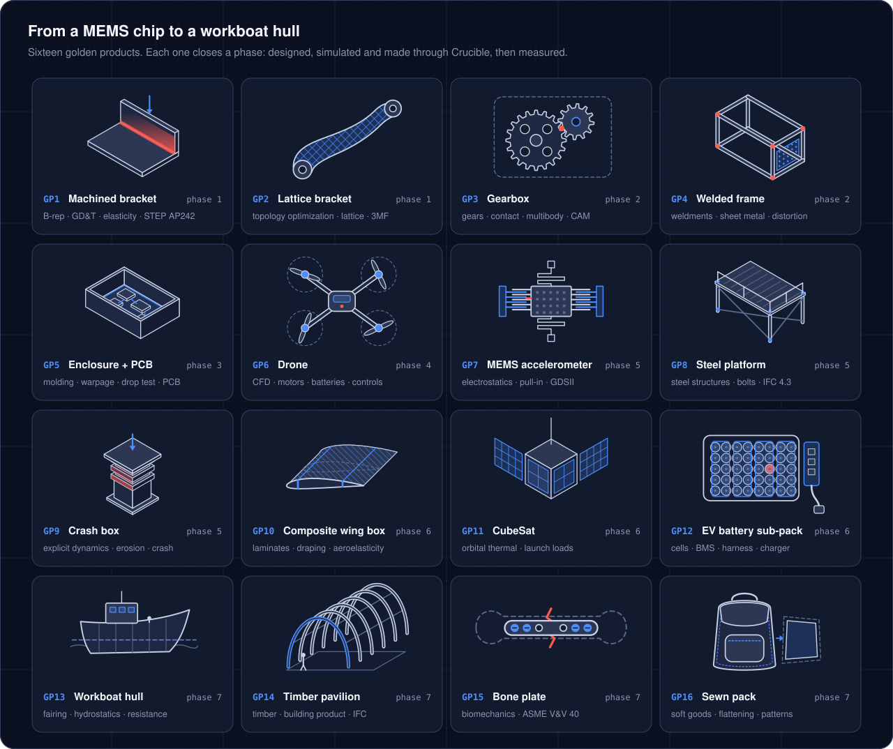
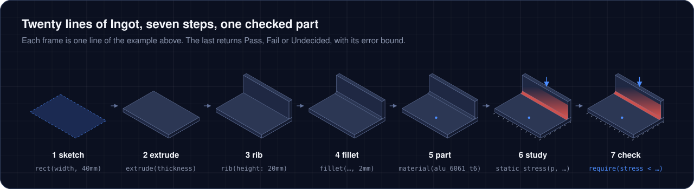
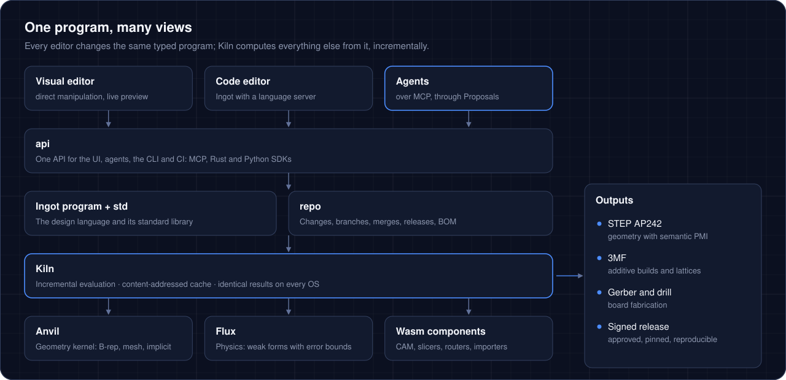
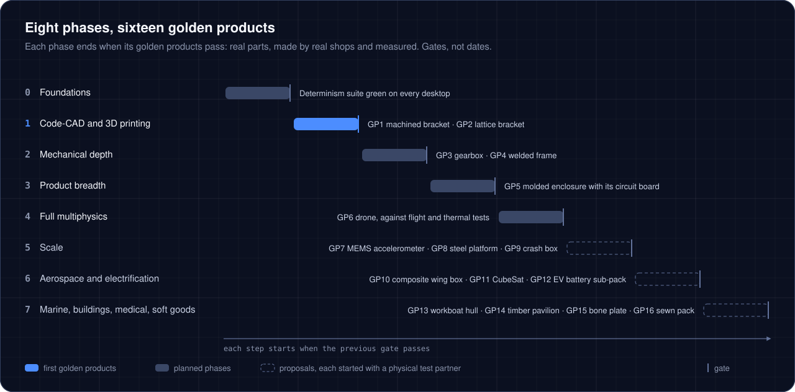

<p align="center">
  
</p>

<p align="center">
  <a href="docs/README.md"></a>
  <a href="docs/contract.md"></a>
  <a href="docs/spec/"></a>
  <a href="docs/review/"></a>
  <a href="LICENSE"></a>
  <a href="LICENSE-DOCS"></a>
</p>

<p align="center">
  <a href="#what-you-can-build">What you can build</a> ·
  <a href="#twenty-lines-to-a-checked-part">Example</a> ·
  <a href="#how-it-fits-together">Architecture</a> ·
  <a href="#roadmap">Roadmap</a> ·
  <a href="docs/README.md">Read the spec</a> ·
  <a href="#contributing">Contributing</a>
</p>

> [!NOTE]
> Crucible is being specified in the open, in full detail, before it is built. This repository holds the binding architecture contract, twelve subsystem specs and a six-reviewer adversarial review. The Rust code will grow beside `docs/`, built against that spec. Nothing runs yet.

## The idea

A physical product today lives in separate tools for CAD, simulation, CAM, electronics and PLM, joined by file exports and handoffs. Crucible puts the whole product in **one typed program**. Geometry, physics, manufacturing data and the bill of materials are all computed from that program, so one edit reaches the stress check, the drawing, the toolpath and the BOM in the same evaluation.

- **One model, three editors.** The visual editor, the code editor and AI agents edit the same program. Nothing exists only in the GUI.
- **The compiler checks physics.** Units, dimensions and tolerances are types. Every approximation carries its error, in a stated norm.
- **Every claim has an oracle.** No capability ships without a machine-checkable test that agents cannot edit.
- **Determinism is a feature.** Same inputs and versions give identical outputs. Nothing depends on clocks, randomness or thread order.
- **No privileged code.** Built-in features use only the mechanisms anyone can use. If you or an agent can't build a feature, neither can the core team.
- **Open core, interop first.** Kernel, language and standard library are open source, and open standards such as STEP, IFC and 3MF are first-class.

## What you can build

<p align="center">
  
</p>

Each phase of the roadmap closes on a **golden product**: a real product designed and verified in Crucible, made by a real shop or printer, and measured by an outside lab. The range runs from a MEMS accelerometer to a bolted steel platform, an EV battery sub-pack and a workboat hull. Every model states where it is valid, and the spec says plainly what stays out of reach.

## Twenty lines to a checked part

This is the contract's canonical example: an aluminium L-bracket with a stiffening web, a load case and a stress requirement.

```rust
use std::mech::{sketch, rect, extrude, rib, fillet, part}
use std::materials::alu_6061_t6
use std::sim::quick::static_stress

/// L-bracket with a stiffening web.
#[feature(category: "Structure", icon: "bracket")]
pub feature bracket(
    #[ui(step: 5mm)]
    width: Length in 20mm..=400mm = 60mm,
    thickness: Length = 4mm ± 0.1mm,
    load: Force = 1.2kN,
) -> Part {
    let outline = rect(width, 40mm)
    let base = sketch(plane.xy) { outline } |> extrude(thickness)
    let web = base.edge(role: end(outline.top)) |> rib(height: 20mm, t: thickness)
    let body = base + web
    let solid = body |> fillet(body.edges(new), 2mm)
    let p = part(solid, name: "Bracket").material(alu_6061_t6)
    let clamp = base.face(role: start_cap)
    let study = static_stress(p, fixed: clamp, force: load, on: web.face(role: end_cap))
    let stress = study.von_mises.max(over: p.away_from([clamp, web.face(role: end_cap)], 2 * thickness))
    p.require(stress < 0.6 * p.material.yield_strength(at: 20degC))
}
// width + load  →  error ING3001: cannot add Length and Force
```

<p align="center">
  
</p>

The `#[ui(...)]` annotation and the `20mm..=400mm` range give the visual editor its slider, so dragging it rewrites the source. Edges are picked by the role they play, such as the end of the outline's top edge, never by index. Mix up units and the program never runs:

```text
width + load
error ING3001: cannot add Length and Force
```

The stress check reads a regularized maximum away from the clamp and the loaded face, where stress can be singular. It returns **Pass**, **Fail** or **Undecided**, with its error bound, and never a silent guess.

## How it fits together

<p align="center">
  
</p>

| Name | What it is |
| --- | --- |
| **Ingot** | The design language: pure, strict and statically typed, with units and tolerances as types |
| **Anvil** | The geometry kernel: exact B-rep, meshes and implicit shapes |
| **Flux** | The physics engine: weak forms compiled through one kernel IR, with error budgets (working name) |
| **Kiln** | Incremental evaluation over a content-addressed cache |
| **`api`** | One API for the UI, agents, the CLI and CI, served over MCP and native SDKs |

Agents work on branches and deliver **Proposals**: a branch, a rationale and a CI report. Anything that leaves Crucible, such as a release, an export or a print job, is prepared as a plan and runs only after a person approves that exact plan. Crucible sends programs to machines but never starts a machine tool itself.

## Roadmap

<p align="center">
  
</p>

Phase 1 is the wedge: code-CAD and 3D printing, closed by a machined aluminium bracket and a metal-printed lattice bracket, each load-tested. Phases end at gates, not dates: Crucible is built by agent swarms against tests they cannot edit, directed by one founder, with outside shops and labs for everything physical. Phases 5 to 7 are proposals, each started only with a physical test partner. Every desktop OS is a first-class target: Windows, macOS, Linux and the browser, with identical features.

## Read the spec

1. [`docs/spec/00-overview.md`](docs/spec/00-overview.md): the platform on one page.
2. [`docs/contract.md`](docs/contract.md): names, principles, core types, decided architecture, roadmap and performance targets. Binding on every subsystem.
3. [`docs/spec/`](docs/spec/): one spec per subsystem, from the Ingot language to platform and performance.

[`docs/README.md`](docs/README.md) has the full map and the live status of every subsystem.

## Contributing

The most valuable contribution right now is a hard look at the spec.

- **Found a flaw?** Open an issue naming the subsystem, the section and what's wrong, with a source if you have one. The six reviews in [`docs/review/`](docs/review/) show the bar.
- **Disagree with the contract?** It is binding, so don't work around it. Propose a contract change request with your reason.
- **Editing a spec?** Run the check before opening a pull request:

  ```bash
  python3 docs/tools/check.py docs/spec/06-mechanical.md --base round-1
  ```

- **Sign off your commits** under the [Developer Certificate of Origin](https://developercertificate.org/) with `git commit -s`.

## License

Code, including the spec tools, is licensed under [Apache-2.0 WITH LLVM-exception](LICENSE). The specification and other documentation are licensed under [CC BY 4.0](LICENSE-DOCS). Crucible, Ingot, Anvil, Flux and Kiln are working names; Flux will be renamed before any interface freezes.
